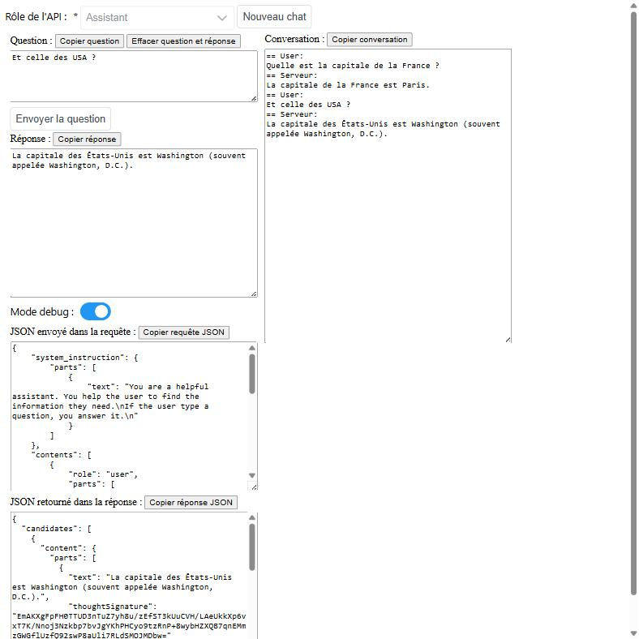
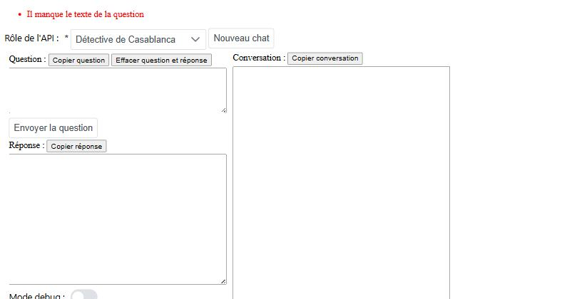

# TP 1 - Accès direct à l'API de Gemini (Aya Tijini)

Application Web (Jakarta EE 11, JSF/PrimeFaces) qui reprend l'interface du TP 0, mais cette fois le serveur envoie la
question de l'utilisateur à un LLM (**Gemini**) et affiche sa réponse. L'API est appelée **directement**, sans
librairie : client REST JAX-RS et documents JSON manipulés avec Jakarta JSON Processing. Un mode « debug » permet de
voir les JSON échangés avec l'API.

## Aperçu du rendu

L'application tourne sur un serveur local (`localhost`), qui n'est pas accessible depuis un autre ordinateur.
Voici donc des captures d'écran de l'application en fonctionnement.

**Rôle « Assistant », mode debug activé, deux questions à la suite** (« Quelle est la capitale de la France ? »
puis « Et celle des USA ? ») : la réponse s'affiche à gauche, l'historique à droite, et en dessous le JSON envoyé
dans la requête et celui retourné par l'API.



**Envoi d'une question vide :** le message d'erreur s'affiche en rouge en haut de la page (comme au TP 0).



## Versions utilisées

| Élément | Version |
|---|---|
| Java (JDK Temurin) | 25 |
| Jakarta EE (Web Profile) | 11 |
| Serveur d'application | Payara 7.2026.10 |
| PrimeFaces | 16.0.1 |
| Maven | 3.9.x |
| Modèle Gemini | `gemini-3.5-flash-lite` |

## Lancer l'application

1. Créer une clé pour l'API de Gemini (Google AI Studio) et la mettre dans la variable d'environnement utilisateur
   `GEMINI_KEY` (la clé n'est jamais écrite dans le code ; elle est lue dans le constructeur de `LlmClientPourGemini`).
   Redémarrer Payara / IntelliJ pour que la variable soit prise en compte.
2. Construire le WAR : `mvn clean package` (génère `target/tp1AyaTijini-1.0-SNAPSHOT.war`).
3. Déployer le WAR sur Payara, par exemple avec IntelliJ IDEA (configuration « Payara Server > Local »)
   ou avec `asadmin deploy target/tp1AyaTijini-1.0-SNAPSHOT.war`.
4. Ouvrir http://localhost:8080/tp1AyaTijini-1.0-SNAPSHOT/ (la page `index.xhtml` est la page d'accueil).

## Organisation du code

| Fichier | Rôle |
|---|---|
| `src/main/webapp/index.xhtml` | Page JSF : rôle système, question, réponse, conversation, bouton « Mode debug » et panel `paneldebug` |
| `src/main/webapp/resources/` | Fichiers CSS et JavaScript utilisés par la page |
| `.../tp1/jsf/Bb.java` | Backing bean (`@ViewScoped`) : état de la page, délègue le travail à `JsonAdapterPourGemini` |
| `.../tp1/llm/JsonAdapterPourGemini.java` | Construit le JSON des requêtes, extrait la réponse du JSON reçu et **conserve l'historique de la conversation** (`@Dependent`) |
| `.../tp1/llm/LlmClientPourGemini.java` | Client REST : lit la clé dans `GEMINI_KEY` et envoie la requête POST à l'endpoint de Gemini (`@Dependent`) |
| `.../tp1/llm/LlmInteraction.java` | Record `(questionJson, reponseJson, reponseExtraite)` retourné au backing bean |
| `.../tp1/llm/RequeteException.java` | Exception levée quand l'API répond avec un statut différent de 200 |

Enchaînement : `Bb.envoyer()` → `JsonAdapterPourGemini.envoyerRequete(question)` → `LlmClientPourGemini.envoyerRequete(...)`
→ API de Gemini, puis la réponse remonte dans l'autre sens sous la forme d'un `LlmInteraction`.

## Le JSON échangé avec Gemini

Les API des LLM sont **sans état** : le serveur de Gemini ne garde aucune mémoire entre deux requêtes. À chaque
nouvelle question, `JsonAdapterPourGemini` renvoie donc tout le début de la conversation :

```json
{
  "system_instruction": { "parts": [ { "text": "<rôle système>" } ] },
  "contents": [
    { "role": "user",  "parts": [ { "text": "Quelle est la capitale de la France ?" } ] },
    { "role": "model", "parts": [ { "text": "La capitale de la France est Paris." } ] },
    { "role": "user",  "parts": [ { "text": "Et celle des USA ?" } ] }
  ]
}
```

- `system_instruction` : le rôle système, qui dit à Gemini comment se comporter ;
- `contents` : l'historique, dans l'ordre, avec `"role": "user"` pour l'utilisateur et `"role": "model"` pour Gemini.

C'est la classe `JsonAdapterPourGemini` (attribut `requeteJson`) qui garde cet historique : la méthode
`ajouteQuestionDansJsonRequete` y ajoute chaque question et `extractReponse` y ajoute chaque réponse de l'API.

## Rôle système pour le bonus : « Détective de Casablanca »

En plus des trois rôles prédéfinis (Assistant, Traducteur Anglais-Français, Guide touristique), j'ai ajouté un rôle
dans la liste déroulante : le LLM joue **Sam Barka, un détective privé désabusé de la médina de Casablanca dans les
années 1950**. Il répond à toutes les questions comme à une enquête (première personne, ton de film noir, phrases
courtes, ironie, métaphores sur la pluie, le café et la brume de l'Atlantique). Ses réponses restent exactes et il
termine toujours par « Affaire classée. » suivi d'un indice pour aller plus loin.

## Erreurs provoquées volontairement (puis annulées avec Git)

Ces deux modifications n'ont **pas** été commitées : le code est revenu à l'état du dernier commit avec
`git restore src/main/java`.

| Modification | Message affiché |
|---|---|
| Mauvaise clé dans `LlmClientPourGemini` | `400 : Bad Request` ... `API key not valid. Please pass a valid API key.` (`API_KEY_INVALID`) |
| Rôle `"user"` remplacé par `"system"` dans `creerRequeteJson` | `400 : Bad Request` ... `Role 'system' is not supported. Please use a valid role: MODEL, USER.` |

Dans les deux cas, `JsonAdapterPourGemini` lance une `RequeteException`, que `Bb.envoyer()` attrape pour afficher
l'erreur en rouge en haut de la page.

## Écarts par rapport à l'énoncé

- `JsonAdapterPourGemini.extractReponse` : le code fourni ne lisait que `parts[0]`. Or Gemini découpe parfois sa
  réponse en plusieurs `parts` (par exemple « ...Washington, » puis « D.C. »), ce qui tronquait la réponse affichée.
  La méthode concatène maintenant le texte de tous les `parts`.
- `LlmClientPourGemini` : ajout de l'import de `jakarta.annotation.PreDestroy`, absent du squelette fourni.
- `pom.xml` : PrimeFaces 16.0.x n'a pas d'artefact avec le classifier `jakarta` sur Maven Central ;
  le classifier est donc retiré (comme au TP 0).
- Ajout d'un fichier `WEB-INF/faces-config.xml` (vide, version 4.1), comme au TP 0.
